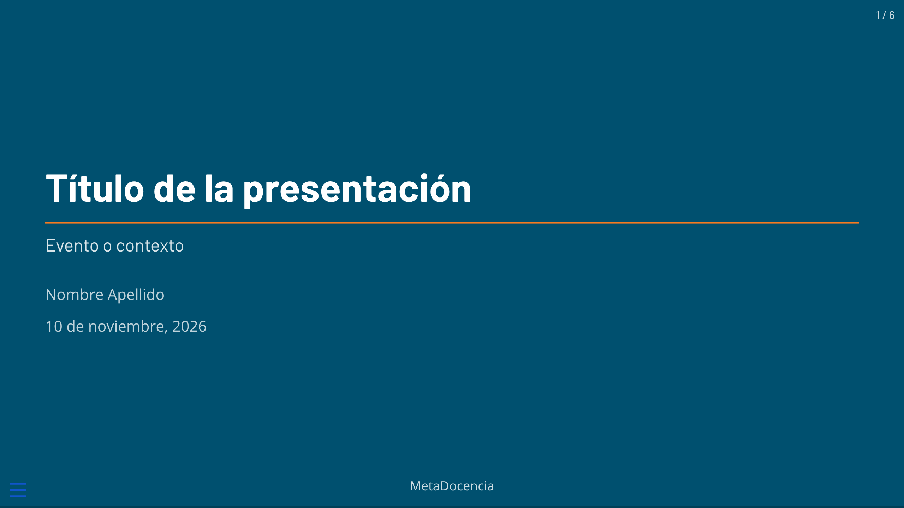
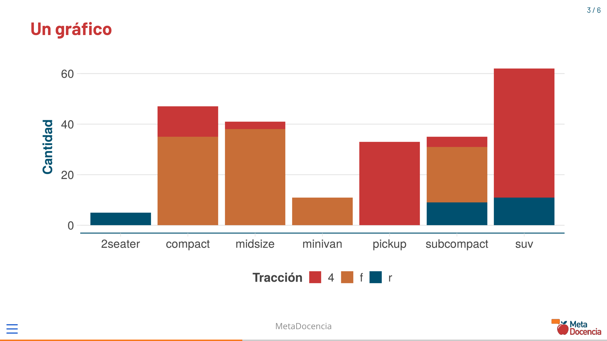
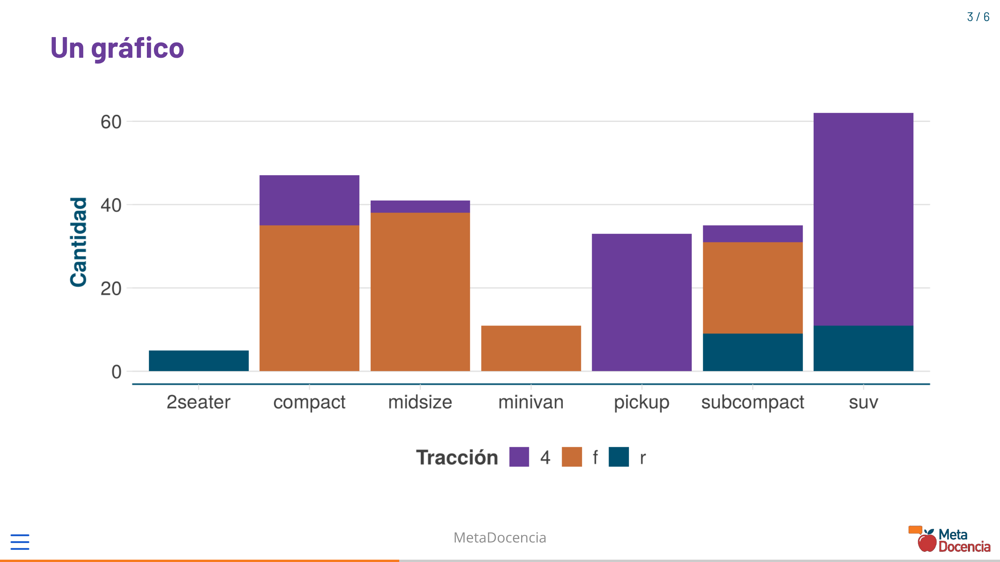

# ¿Cuántos tipos de documentos distintos tiene tu organización?


## Distintos productos, distintas formas de darle estilo

<br>
Los materiales de la organización comparten una identidad visual, pero cada herramienta requiere una forma diferente de implementarla.

::: {style="font-size:1.35em;"}

| Producto | Herramienta | Estilo | 
|---|---|---|
| Documentos de texto (pdf) | Google Docs | Plantilla preformateada |
| Presentaciones | Google Slides | Plantilla preformateada |
| Reportes (texto y visualizaciones) | `.qmd` / `.Rmd` | Estilos definidos a medida |
| Contenidos para la web | `.qmd` / `.Rmd` | Estilos definidos a medida |

:::

## Crear un documento es fácil. Mantener muchos, no tanto.

<br>

- ¿Cuantas veces tenemos que aplicar los mismos formatos?
- Cuando cambia un logo, una tipografía o un color: ¿Cuántos archivos hay que modificar?
- ¿Cómo sabemos qué archivos están desactualizados?


## Dos roles con necesidades muy distintas

<br>

::: {style="font-size:1.2em; margin-top:1em;"}

| | Quienes producen el contenido | Quienes mantienen la identidad visual |
|:--:|:------:|:------:|
| **Qué hacen** | Editan texto, analizan datos, generan visualizaciones | Definen colores, tipografías, logo y plantillas |
| **Qué necesitan** | No pensar en colores, fuentes ni logos | Actualizarla **en un solo lugar** y que se aplique a todos los documentos |


:::


## ¿Por qué crear un paquete?

<br>

:::: {.columns .tarjetas}

::: {.column width="31.5%"}
{fig-align="center" width="64"}

### Crear


Documentos nuevos con la identidad visual ya aplicada

`nuevo_documento()`
:::

::: {.column width="31.5%"}
{fig-align="center" width="64"}

### Diagnosticar

Identificar documentos que usan estilos desactualizados

`diagnosticar_brand()`
:::

::: {.column width="31.5%"}
{fig-align="center" width="64"}

### Actualizar

Aplicar los estilos vigentes sin modificar el contenido

`actualizar_brand()`
:::

::::

::: {.destacado}

Quien crea contenido edita un `.qmd`. Quien mantiene el diseño actualiza el paquete (`_brand.yml` y plantillas)

:::

## Cómo se ve en la práctica

<br>

::: {style="font-size:1.7em;"}
```r
library(metadocencia)
listar_tipos()
```

```
          tipo               formato
1 reporte-html     metadocencia-html
2  reporte-pdf    metadocencia-typst
3 presentacion metadocencia-revealjs
4         nota    metadocencia-typst
                                                   descripcion
1 Reporte HTML autocontenido con índice y secciones numeradas.
2      Reporte PDF (Typst) con encabezado y pie institucional.
3                Presentación RevealJS con tema institucional.
4       Nota o carta breve en PDF con Para / De / Fecha / Ref.
```
:::


## Cómo se ve en la práctica

<br>

::: {style="font-size:1.45em;"}
```r
nuevo_documento("charla-demo", tipo = "presentacion")
```

```
✔ Documento creado: './charla-demo'
• Editá 'charla-demo.qmd'.
• Renderizá con el botón Render o con `quarto render charla-demo.qmd`.
```
<br>

```r
fs::dir_tree("charla-demo", recurse = 1)
```

```
charla-demo
├── _extensions
│   └── metadocencia
├── _quarto.yml
└── charla-demo.qmd
```
:::


## Cómo se ve en la práctica

<br>

::: {style="font-size:1.8em;"}
```yaml
---
title: "Título de la presentación"
subtitle: "Evento o contexto"
author: "Nombre Apellido"
date: today
format:
  metadocencia-revealjs:
    footer: "MetaDocencia"
title-slide-attributes:
  data-background-color: ""
```
:::

Colores, tipografías y logo no están acá: los aporta `metadocencia-revealjs`.


## Plantillas

<br>

::: {layout-ncol="2"}
{style="border:1px solid #DDDDDD;"}

{style="border:1px solid #DDDDDD;"}
:::

`quarto render charla-demo.qmd`


## Cuando cambia la identidad...

<br>

::: {style="font-size:1.8em;"}
```diff
# brand/_brand.yml
-    rojo: "#C83737"
+    rojo: "#6A3D9A"        

# _extension.yml y DESCRIPTION
-    version: 1.0.0
+    version: 1.0.1
```
:::

Se reinstala el paquete. Los documentos ya creados siguen con la versión anterior.


## Cuando cambia la identidad...

<br>

::: {style="font-size:2.0em;"}
```r
diagnosticar_brand("documentos", recursivo = TRUE)
```

```
! '~/documentos/charla-congreso' (desactualizado)
! '~/documentos/informe-anual' (desactualizado)
! '~/documentos/nota-convenio' (desactualizado)
```
:::


## Cuando cambia la identidad

<br>

::: {style="font-size:1.6em;"}
```r
actualizar_brand("documentos", recursivo = TRUE)
```

```
✔ Actualizado: '~/documentos/charla-congreso'
✔ Actualizado: '~/documentos/informe-anual'
✔ Actualizado: '~/documentos/nota-convenio'
ℹ 3 documento(s) actualizado(s) a la versión 1.0.1.
```
<br>

```r
diagnosticar_brand("documentos", recursivo = TRUE)
```

```
✔ '~/documentos/charla-congreso' (actualizado)
✔ '~/documentos/informe-anual' (actualizado)
✔ '~/documentos/nota-convenio' (actualizado)
```
:::

## Cuando cambia la identidad

<br>

::: {layout-ncol="2"}
{style="border:1px solid #DDDDDD;"}

{style="border:1px solid #DDDDDD;"}
:::


## La estructura del paquete

<br>

::: {.columns}
::: {.column width="62%"}
```
metadocencia/
├── DESCRIPTION 
├── R/
│   ├── nuevo_documento.R
│   ├── actualizar_brand.R
│   ├── colores.R,  ggplot.R
│   └── tipos.R, rutas.R
├── inst/extdata/
│   ├── _extensions/metadocencia/
│   │   ├── _extension.yml
│   │   ├── brand/  (_brand.yml, logo, fuentes)
│   │   ├── html/, revealjs/, typst/
│   │   └── destacado.lua
│   └── plantillas/  (.qmd)
├── man/, tests/testthat/
└── _pkgdown.yml, .github/workflows/
```
:::
::: {.column width="38%"}
**`R/`**: qué se puede hacer (crear, diagnosticar, actualizar, graficar)

**`inst/extdata/`**: la identidad que "viaja" con el paquete

**`man/`, `tests/`, pkgdown**: documentación y testeos
:::
:::


## El ciclo de mantenimiento

<br>

1. Se cambia `_brand.yml` (o estilos propios de cada producto, o plantillas) en el paquete
2. Se sube la `version` en `_extension.yml` y en `DESCRIPTION`
3. Se reinstala el paquete
4. `diagnosticar_brand()` + `actualizar_brand()` en cada carpeta de documentos
5. Se vuelven a renderizar

::: {.destacado}
**No es automático:** el cambio llega a cada documento cuando se corre `actualizar_brand()`. 
:::


## Instalación

<br>

::: {style="font-size:1.6em;"}

```r
# install.packages("pak")
pak::pak("metadocencia/metadocencia")

```
:::

- R ≥ 4.1 y Quarto ≥ 1.9
- El PDF se genera con Typst (incluido en Quarto), no hace falta LaTeX.
- Pocas dependencias: `cli`, `fs`, `tools`, `utils`, `yaml`. ggplot2 es opcional.


## ¿Cómo lo llevo a otra organización?

<br>

| Quiero cambiar… | Archivo |
|---|---|
| Colores | `brand/_brand.yml` |
| Logo | `brand/logo.png` |
| Tipografías | `brand/fuentes/`, `_brand.yml`, `fuentes.html` |
| Diseño del PDF | `typst/typst-template.typ` |
| Diseño de HTML y diapositivas | `html/estilos.scss`, `revealjs/estilos.scss` |
| Tipos de documento | `R/tipos.R` y `plantillas/` |

Licencia: MIT


## ¿Me conviene?

<br>

::: {.columns}
::: {.column width="60%"}

Para una organización con muchos documentos y una identidad compartida:

- **Menos trabajo repetitivo:** se empieza a escribir sin configurar
- **Más consistencia:** una definición de identidad para documentos y gráficos
- **Mantenimiento sostenible:** los cambios se distribuyen sin reescribir el contenido


:::
::: {.column width="40%"}
{width=260}

[github.com/metadocencia/metadocencia]{style="font-size:.6em;"}
:::
:::

## Materiales de referencia

<br>

- [R package development workshop de Forward](https://forwards.github.io/package-dev/workshops/may-july-2026-cohort-2.html)
- [Libro R Packages de Hadley Wickam](https://r-pkgs.org/)

## ¡Muchas gracias! {.cierre background-color=""}

<br>

::: {.columns}
::: {.column width="50%"}
**Jesica Formoso**


[https://www.linkedin.com/in/jesica-formoso/](https://www.linkedin.com/in/jesica-formoso/)

 [jesica.formoso@gmail.com](mailto:jesica.formoso@gmail.com)

 [jformoso.github.io](https://jformoso.github.io/)

:::
::: {.column width="50%"}
**Irene Vazano**

 [https://www.linkedin.com/in/irene-vazano/](https://www.linkedin.com/in/irene-vazano/)

 [irene.vazano@metadocencia.org](mailto:irene.vazano@metadocencia.org)

 [metadocencia.org/author/irene-vazano/](https://metadocencia.org/author/irene-vazano/)
:::
:::

metadocencia.github.io/metadocencia - info@metadocencia.org
